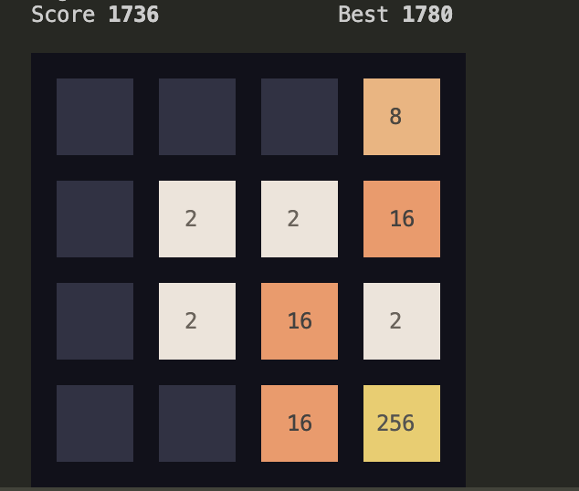

# 2048

Play 2048 in the terminal, built with go & [Bubble Tea](https://github.com/charmbracelet/bubbletea).



## Install

Requires Go 1.26 or newer.

```sh
go install github.com/tobyleye/2048@latest
```

Then run `2048`.

To run from source instead:

```sh
git clone https://github.com/tobyleye/2048.git
cd 2048
go run .
```

## Controls

| Key             | Action                             |
| --------------- | ---------------------------------- |
| `←` `↑` `→` `↓` | Slide the tiles                    |
| `r`             | Start a new game (after game over) |
| `q`             | Quit                               |

## How to play

Slide the tiles to merge matching numbers. Each merge adds the new tile's value to your score. The game ends when the board is full and no moves are left.

Your best score is saved to `~/2048_best_score`.
